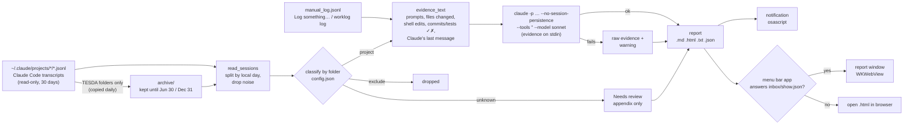
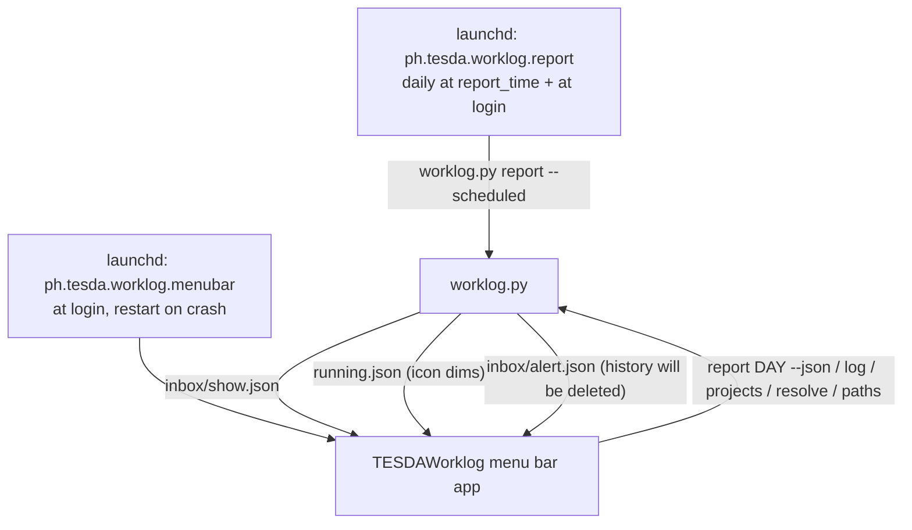

# Architecture

TESDA Worklog is three small pieces glued together with plain files:

- **`worklog.py`** does all the thinking: it reads transcripts, filters them, builds evidence, calls Claude, and writes reports.
- **`TESDAWorklog`** (from `menubar.swift`) is a thin native UI. It never contains report logic; it runs `worklog.py` and shows the files it writes.
- **launchd** decides *when* things run.

## Data flow

Who triggers what:

## Files

| File | Job |
|---|---|
| `worklog.py` | The whole engine and the CLI. Reads transcripts, classifies sessions by folder, merges manual entries, builds evidence, calls `claude -p`, and writes `YYYY-MM-DD.{md,html,txt,json}`. It also handles notification and delivery, and the "should the morning job run now?" logic. Includes a ~100-line Markdown→HTML renderer, so there are no dependencies. |
| `menubar.swift` | The menu bar icon (`list.checklist`), the *Log something…* dialog, and the *Get report now* window (period picker, spinner + Cancel, WKWebView, Copy / Open file / Regenerate / Close). It runs `worklog.py` as a background `Process`. Once a second it checks `inbox/show.json` and `running.json`. |
| `assets/make_icon.swift` | Draws the octopus icon with AppKit and builds `AppIcon.icns` with `iconutil`. There are no image files to maintain by hand. |
| `install.sh` | Copies the app to `~/Library/Application Support/TESDA-Worklog`, compiles Swift, creates the config, the `worklog` command and the Documents link, and writes and loads both LaunchAgents. Safe to run again. |
| `uninstall.sh` | Removes jobs, binaries and the command. Keeps data unless you pass `--all`. |
| `tests/make_fixtures.py` | Writes synthetic transcripts that mimic the real JSONL format, including the noisy parts. |
| `tests/test_worklog.py` | 38 stdlib `unittest` tests. Claude is replaced by a fake executable that records its arguments. |
| `reference/` | The earlier prototype, kept for comparison. |

Data files (all in the app folder): `config.json`, `manual_log.jsonl` (one JSON object per entry), `state.json` (last morning delivery, last archive purge, alerts already shown), `running.json` (the PID of a report being written), `inbox/` (requests to the menu bar app), `archive/` (copies of TESDA transcripts), `logs/`, `reports/`.

## How a transcript becomes evidence

Claude Code writes one JSONL file per session. Only lines with `type` set to `user` or `assistant` matter. They carry `cwd`, `timestamp` (UTC), `sessionId`, `gitBranch`, `isMeta`, `isSidechain` and `message.content` (a string or a list of `text` / `tool_use` / `tool_result` / `thinking` / `image` blocks). These were checked against real files from Claude Code 2.1.316. Two other line types turned out to be useful:

- `ai-title` lines give each session a short title.
- `uuid` lets us skip messages repeated after a resume.

- **Your prompts:** `user` lines that aren't `isMeta`, aren't system-generated (`promptSource: system`, `origin.kind` other than `human`), and don't start with Claude Code plumbing such as `<command-name>`, `<local-command-stdout>`, `<task-notification>`, `[Image…`, `[Request interrupted…`. `<system-reminder>` blocks are cut out, and `<pasted_content>` wrappers are removed while the pasted text is kept.
- **Files changed:** `Edit`, `Write`, `MultiEdit` and `NotebookEdit` tool calls whose `tool_result` wasn't an error.
- **Shell edits:** Bash commands that write files (`sed -i`, `perl -i`, `python3 - <<EOF`, `cat >`, `tee`, `git apply`). In auto mode Claude often edits this way, and these edits don't appear as Edit calls.
- **Notable commands:** commits, pushes, tests, builds, lints and deploys, each marked ✓ or ✗ from its tool result.
- **Outcome:** Claude's last text message of that day.
- **Day boundaries:** each message is placed by its *local* date, so a session that runs past midnight contributes to both days.
- **Not counted:** sub-agent ("sidechain") messages.

## Key design decisions

**No hooks, no recorder.** Claude Code already keeps a complete transcript of every session. Reading it after the fact means nothing runs while you work, nothing can slow Claude down, and there's nothing to break when Claude Code updates its hook system. Past days can also be reported, including days from before the app was installed (within the retention window).

**TESDA-only by explicit allow-list.** Misreporting another employer's work in a government accomplishment report is worse than missing a line. So only listed folders count. Unknown folders are shown under *Needs review* for you to decide, and their content is never sent to the summary prompt.

**No API key: your own `claude` CLI.** `claude -p` runs headless on your Pro plan:
- `--no-session-persistence` stops the report job from appearing in its own history.
- `--tools ""` makes it a pure text task: Claude can't read files or run commands.
- The prompt states the rules: never invent work; "done" needs evidence (changed files with reported success, a commit, or passing tests); manual entries are true; no time-as-achievement; no filler.

**Always produce something.** If Claude fails (not logged in, usage limit, timeout), the report is still written with the raw evidence and a clear warning, and the window shows a banner. `--no-ai` gives the same thing on purpose.

**The app is copied off T7.** External drives may be unmounted or asleep at 8 AM, and macOS restricts background access to removable volumes. The source stays on T7; the runnable copy, config, logs and reports live in `~/Library/Application Support`.

**Reports are in the app folder, linked from Documents.** During testing, the background job was refused (`Operation not permitted`) when it tried to replace a report in `~/Documents` that Terminal had created. That's macOS privacy protection (TCC). So reports are written where no such gate applies, and `~/Documents/TESDA-Worklog/reports` is a link to them.

**TESDA history: copy, don't configure.** You asked for TESDA transcripts to be kept until Jun 30 / Dec 31, and other projects to keep Claude Code's 30 days. Claude Code's `cleanupPeriodDays` is global and rolling, so it can't do that. Instead, the daily job copies transcripts from TESDA folders into the app's own `archive/`. After alerts 7 days before and on the day, it deletes them the morning after each purge date. Claude Code's settings and `~/.claude/projects` are never modified. A purged half-year isn't re-archived from transcripts that Claude Code hasn't cleaned up yet: `state.json` records the cutoff.

**Plain files for inter-process communication.** The 8 AM job writes `inbox/show.json`, and the menu bar app deletes it within a second and opens the window. If nobody deletes it within a few seconds, the app isn't running, so the job opens the HTML in the browser instead. `running.json` (with a PID) dims the icon while any report is being written, wherever it was started. No sockets, URL schemes or app bundle needed.

**launchd fires daily, Python decides.** The plist fires every day at `report_time` and at login. `worklog.py report --scheduled` checks if today is a workday, if it's after `report_time`, and if today's report was already delivered (`state.json`). That makes workdays configurable without editing the plist, and it gives catch-up after sleep (launchd runs missed calendar jobs on wake) and after power-off (login).

**A tiny app bundle, not an Xcode project.** `install.sh` assembles `~/Applications/TESDA Worklog.app` by hand: an Info.plist, the `swiftc` binary and the icon, signed ad-hoc. `LSUIElement` keeps it a menu-bar app, and it switches to a regular app (Dock tile, ⌘-Tab) only while the report window is open. launchd starts it at login with `--login`, which means "stay quiet". Opened from the Dock or Finder, LaunchServices recognises the running copy and sends it a *reopen* event, which shows the window. If a second copy ever starts anyway, it asks the first copy (via `inbox/show.json`) to show the window and quits.

**Small, boring tech.** Python standard library (works with Apple's Python 3.9), one Swift file compiled with `swiftc` (no Xcode project), launchd, osascript.

## Known limitations

- **The folder is the only signal.** Sessions started in a shared folder (like your home folder) can't be split by project, so they go to *Needs review*.
- **Evidence is a proxy.** Shell edits are recognised by pattern, so unusual ones are missed. "Claude reported success" is judged by the model from Claude's last message. Always review before submitting; the footer says so.
- **Work outside Claude Code** (Figma, browser, meetings) only appears if you log it.
- **Transcript format is undocumented.** A Claude Code update could rename fields. The tests use the shape seen in 2.1.316. If reports suddenly come up empty, run `worklog sessions` to check.
- **Retention.** Claude Code deletes transcripts after 30 days. Only TESDA-folder sessions are archived, and only from install day onwards, so *Needs review* sessions are lost after 30 days. At install the archive held 5 TESDA sessions (21 MB); expect tens to a few hundred MB per half-year.
- **Notifications** appear as coming from *Script Editor* (an osascript limitation) and need permission once.
- **One evidence budget.** Very busy days are trimmed to about 60k characters of evidence (fewer prompts per session) to keep the Claude call fast.
- **The app isn't code-signed**, which is fine for a locally compiled personal tool. A distributable version would need a signed `.app` bundle.
- **Automation hook.** The menu bar app has a test-only automation mode (`WORKLOG_AUTOMATION=1`, never set by the installer). It drives the real buttons from a script, because terminals can't click menu bar apps.
